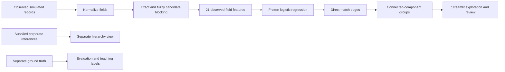

# Banking Client Entity Resolution

A Python portfolio project that identifies duplicate company records across
simulated banking systems and explores supplied corporate relationships in
Streamlit. It demonstrates data cleaning, candidate retrieval, interpretable
matching features, model comparison, leakage controls and graph-based grouping.

**Data:** the benchmark is fully synthetic. The default Indian finance demo uses
real public company names with simulated source records, errors, addresses,
PIN codes and `DEMO-IN` identifiers. It contains no actual customer or bank-system
data and implies no affiliation or endorsement. Public references are a dated
snapshot, with source URLs and retrieval dates saved alongside them.

[Demo walkthrough](APP_GUIDE.md) | [Architecture and data](docs/ARCHITECTURE.md) ?
[Publication notes](docs/PUBLICATION.md) | [MIT license](LICENSE)

## What you can explore

- Compare records using 21 observed-field features and a frozen logistic regression
  model; inspect the evidence and its uncalibrated score.
- Try spelling errors, missing fields, unrelated companies and related but separate
  legal entities through guided examples.
- Explore complete duplicate groups, direct match edges, singletons and review
  flags; download a group's simulated observed records.
- View supplied public corporate relationships separately from duplicate matching.
- Inspect the original synthetic benchmark and saved embedding comparison.

The five app pages are **Start here**, **Compare two company records**,
**Explore duplicate groups**, **Explore corporate relationships**, and
**How it works and limitations**. The [walkthrough](APP_GUIDE.md) includes actual
record labels and source references.

## Run locally

Use **Python 3.12**. The saved model and pinned dependencies were produced with
that Python minor version. Run these commands from a clone's root directory.

Windows PowerShell:

```powershell
python -m venv .venv
.\.venv\Scripts\python.exe -m pip install -r requirements.txt
.\.venv\Scripts\python.exe -m streamlit run app.py
```

macOS / Linux:

```bash
python3.12 -m venv .venv
./.venv/bin/python -m pip install -r requirements.txt
./.venv/bin/python -m streamlit run app.py
```

Open **http://127.0.0.1:8501**. Stop with `Ctrl+C`. Restart after source edits;
file watching is disabled in the supplied local configuration. Keep the saved
`data/`, `models/`, `outputs/` and `reports/` folders when cloning.

The app reads the included artifacts and scores comparisons without training or
rerunning evaluation. No API keys, paid services, PyTorch or encoder downloads
are required. Initial package installation needs internet access. An existing
uv-managed environment can install with
`uv pip install --python .venv/Scripts/python.exe -r requirements.txt`
(use `.venv/bin/python` on macOS/Linux).

## How it works



Duplicate records describe the **same legal entity**. A parent and subsidiary are
separate legal entities even when they share a name or office. Supplied hierarchy
edges never become duplicate labels or model features.

The original dataset contains **757 records for 300 fictional entities**. Entire
corporate families stay within one train/validation/test partition before pair
creation. Scaling and fitting use training candidates only. Ground truth is kept
separate from retrieval, features and prediction.

The Indian demo contains **24 simulated records for six named companies**. One
saved run of the unchanged model produced 66 candidates, 28 direct match links
and 8 predicted groups. These are descriptive counts; **Indian-demo accuracy was
not evaluated**. Educational expectations never replace model decisions.

## Recorded benchmark results

The original held-out synthetic split has **154 records, 60 entities and 309
candidate pairs**. These figures are saved results, not a new evaluation run.

| Measure | Saved result |
| --- | ---: |
| Blocking recall over all true duplicate pairs | 99.36% (156/157) |
| Candidate precision, logistic regression | 100.00% (151/151) |
| Candidate recall, logistic regression | 96.79% (151/156) |
| Candidate F1, logistic regression | 98.37% |
| End-to-end direct-pair recall, including blocking misses | 96.18% (151/157) |
| Cluster pairwise F1 over all record pairs | 99.04% |

Candidate metrics cover retrieved pairs. Cluster metrics also count pairs joined
transitively through graph paths, so they answer a different question. See the
[original test report](reports/test_evaluation/v1/original/report.md) for counts,
definitions, errors and limitations.

A separate MiniLM embedding experiment tied the original model's validation F1
and changed no validation decisions. The simpler model was retained. See the
[saved comparison](reports/embedding_experiment/comparison.json); there is no
claim that embeddings improved this project.

## Validate the snapshot

With the virtual environment's Python selected, run:

```text
python scripts/check_publication.py
python -B -m unittest discover -s . -p "test_*.py" -v
```

For example, on Windows replace `python` with
`.\.venv\Scripts\python.exe`. Install `requirements-dev.txt` if you also want
Faker for new synthetic-data experiments. Unit and Streamlit tests use offline
fixtures and the saved artifacts; they do not rerun the historical held-out
benchmark or download encoder weights.

The publication checker uses only the standard library and Git. It verifies
saved checksums and screens the publishable file set for common credential
patterns, private paths and oversized files. GitHub Actions runs these checks
and the tests on Windows and Linux after publication. See
[publication notes](docs/PUBLICATION.md) for the validation actually performed
while preparing this repository and any remaining limitations.

## Repository map

| Path | Purpose |
| --- | --- |
| `app.py`, `portfolio_ui/` | Streamlit pages, verified artifact loading and live scoring |
| `generate_data.py`, `prepare_candidates.py` | Synthetic benchmark generation, normalization, family splits and blocking |
| `pair_features.py`, `train_matcher.py` | Observed-only feature schema, rules and logistic regression |
| `embedding_features.py`, `run_embedding_experiment.py` | Optional offline/real-model embedding experiment |
| `build_clusters.py`, `cluster_views.py` | Duplicate components, review flags and hierarchy views |
| `evaluate_test.py` | Original versioned freeze and held-out evaluation lifecycle |
| `build_india_demo.py` | Separate Indian teaching fixture builder and hash verification |
| `data/`, `models/`, `outputs/`, `reports/` | Included synthetic/reference data and saved evidence |
| `test_*.py`, `scripts/`, `.github/` | Tests, publication checks and CI |

The detailed [development history](docs/DEVELOPMENT_HISTORY.md) preserves the
original stage-by-stage notes. It is historical documentation, not the setup
path for the finished app. The optional embedding dependencies remain in
`requirements-embeddings.txt`; they are unnecessary for the app and unit suite.

## Scope and limitations

This is a small educational example from one synthetic generator and a separate
teaching fixture. Results do not establish real-bank performance or production
readiness. Scores are uncalibrated. Missing evidence is not agreement. Blocking
can miss true pairs, and one incorrect edge can join entire groups. Review flags
are suggestions for inspection, not permission to merge records.

The v1 artifacts and protected sources form an immutable historical snapshot.
Avoid regenerating data, retraining, changing thresholds or rerunning the original
evaluation in the portfolio checkout. Start a separate experiment for pipeline
changes. Automatic line-ending conversion is disabled to preserve checksum
verification across platforms.

See [CONTRIBUTING.md](CONTRIBUTING.md) and [SECURITY.md](SECURITY.md) for change
and data-handling guidance. Project code and original synthetic materials are
available under the [MIT license](LICENSE). Third-party packages, public source
pages and company names retain their respective licenses and rights.
